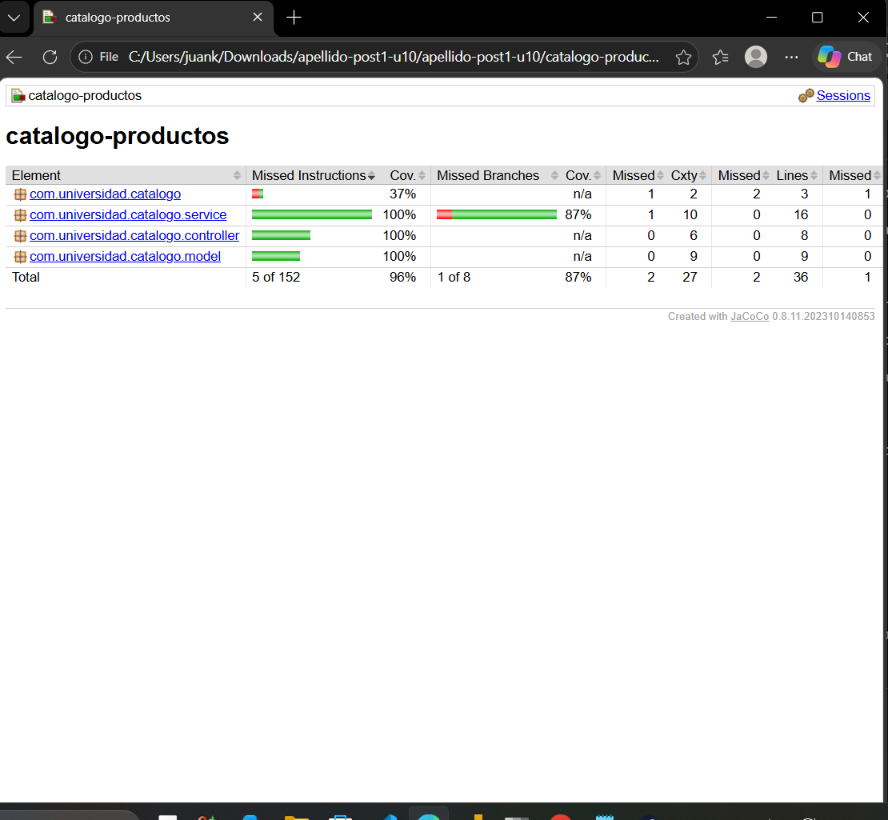
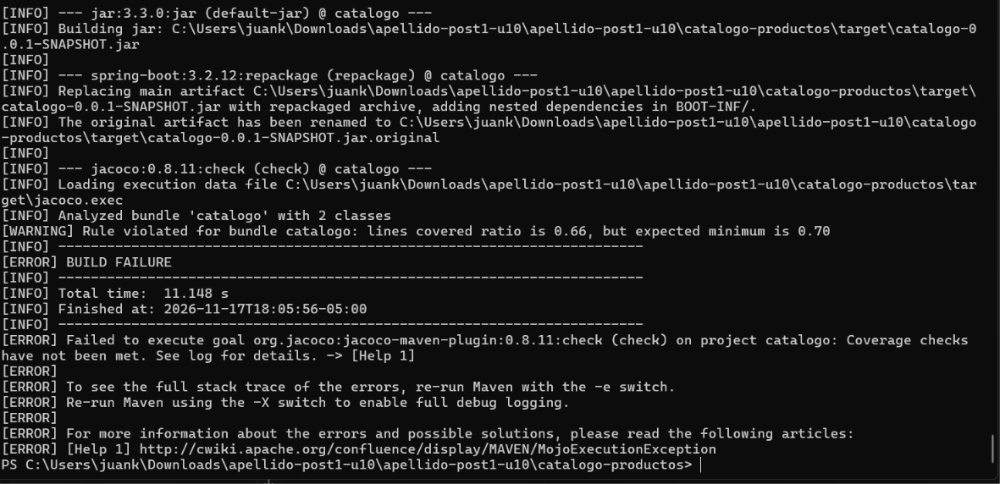
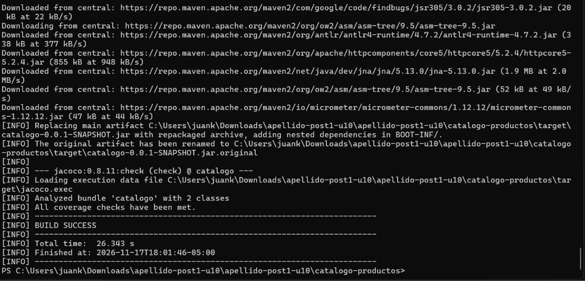
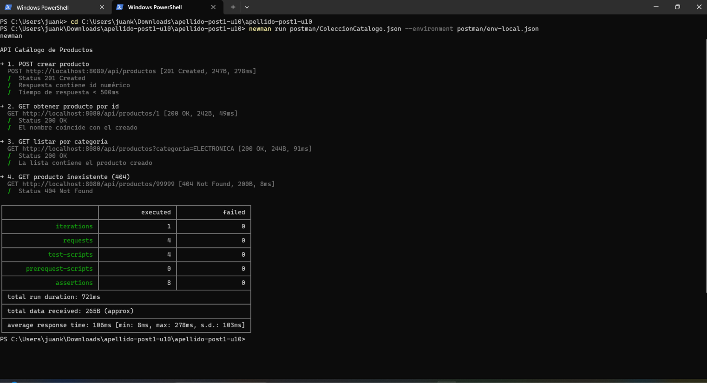

# Post-contenido — Unidad 10: Pruebas de Software en Aplicaciones Web

## Descripción
Repositorio del laboratorio de la Unidad 10 de Programación Web — Séptimo Semestre.
Contiene un único proyecto Maven Spring Boot (`catalogo-productos/`) con una suite de
pruebas unitarias, de integración y de capa web sobre un catálogo de productos, más una
colección Postman versionada (`postman/`) y un umbral de cobertura verificado con JaCoCo.

## Estructura
```
apellido-post1-u10/
├── catalogo-productos/
│   ├── pom.xml
│   └── src/
│       ├── main/java/com/universidad/catalogo/{model,repository,service,controller}
│       └── test/java/com/universidad/catalogo/{service,repository,controller}
├── postman/ColeccionCatalogo.json, env-local.json
└── capturas/   (evidencias)
```

## Parte 1 — Pruebas Unitarias con Mockito y de Integración con @DataJpaTest
- **ProductoServiceTest** usa Mockito (`@Mock`, `@InjectMocks`) para probar la lógica de negocio
  en aislamiento, sin base de datos: caso feliz y casos de error (precio inválido, nombre vacío,
  producto no encontrado) con `assertThrows`.
- **ProductoRepositoryTest** usa `@DataJpaTest` con `TestEntityManager` y H2 en memoria para
  probar las consultas del repositorio (`findByCategoria`).

## Parte 2 — Pruebas Web con @WebMvcTest, Postman/Newman y JaCoCo
- **ProductoControllerTest** usa `@WebMvcTest` con `MockMvc` y `@MockBean` para probar la capa
  web (200, 404, 201, 400) sin levantar el contexto completo.
- La colección Postman **"API Catálogo de Productos"** (`postman/ColeccionCatalogo.json`)
  ejecuta 4 requests con test scripts contra la aplicación en ejecución real. También se corre con:
  `newman run postman/ColeccionCatalogo.json --environment postman/env-local.json`
- **JaCoCo** verifica una cobertura mínima del 70% de líneas con `mvn verify`.

## Orden en que se agregaron los tipos de prueba
1. Servicio (unitarias, la base ancha y rápida de la pirámide).
2. Repositorio (integración acotada a persistencia).
3. Controlador (capa web aislada).
4. Colección Postman (extremo a extremo sobre HTTP real).
5. JaCoCo, al final, para medir la cobertura agregada de las tres capas.

## Decisiones de diseño
1. H2 se usa también para ejecución local (no solo pruebas): el objetivo de la unidad es la
   escritura de pruebas, no el modelado de persistencia contra un motor externo como en la Unidad 8.
2. `buscarPorId` lanza `EntityNotFoundException` en vez de retornar `null`, para que el contrato
   del método sea explícito y verificable con `assertThrows`.
3. `ProductoRepositoryTest` usa `@DataJpaTest` en vez de `@SpringBootTest` para aislar la prueba a
   la capa de persistencia y mantener la suite rápida.
4. `ProductoControllerTest` usa `@WebMvcTest` en vez de `@SpringBootTest` con `TestRestTemplate`,
   para no duplicar cobertura con las pruebas de servicio y repositorio ya existentes.
5. La colección Postman se versiona como archivo `.json`, no como test JUnit, porque prueba el
   contrato HTTP completo como caja negra contra un proceso real, un nivel distinto al de MockMvc.
6. JaCoCo se configura al cierre de la Parte 2, no de la Parte 1, para medir la cobertura agregada
   de las tres capas y evitar que el umbral del 70% se cumpla artificialmente sobre una suite incompleta.
7. Este laboratorio **no** incluye Selenium WebDriver: el dominio es una API REST pura sin vista
   Thymeleaf, y fabricar una vista solo para justificar Selenium contradiría la pirámide de pruebas.
   La colección Postman cumple el rol de prueba de extremo a extremo sobre la superficie real
   de la aplicación (la API HTTP).

## Cómo compilar y ejecutar
Requisitos: Java 17+, Maven 3.9+, Node.js 18+ (solo para Newman).

1. Clonar el repositorio: `git clone [URL-del-repo]`
2. Entrar a `catalogo-productos/` y ejecutar `mvn spring-boot:run`
3. Suite completa con verificación de cobertura:
   `mvn clean verify` (reporte en `target/site/jacoco/index.html`; falla si la cobertura < 70%)
4. Con la aplicación en ejecución: `newman run postman/ColeccionCatalogo.json --environment postman/env-local.json`

> Nota: el proyecto agrega `spring-boot-starter-validation` porque la entidad usa `@NotBlank`
> (`jakarta.validation`), que no viene en las dependencias básicas de start.spring.io.

## Capturas de pantalla




